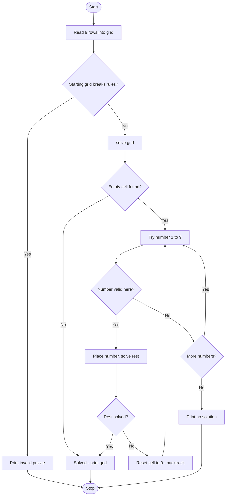

# Case Study 6: Sudoku Solver using Backtracking

**Concepts used:** 2D lists, nested loops, recursion, backtracking

## 1. Problem Statement

Write a program that solves any valid 9x9 Sudoku puzzle. Empty cells are entered as 0. The program must also detect puzzles that already break the rules and puzzles that have no solution.

## 2. Objectives

1. Represent the board as a 2D list.
2. Check whether a number can be placed (row, column, 3x3 box).
3. Solve the puzzle using recursion and backtracking.
4. Report invalid and unsolvable puzzles.

## 3. Assumptions

- Input is 9 rows of 9 digits; 0 means empty.
- Typing 'sample' loads a built-in puzzle.
- Only one solution needs to be found.

## 4. Algorithm

1. Read the 9 rows and convert to a 9x9 grid of numbers.
2. If the starting grid already breaks the rules, print an invalid-puzzle message.
3. Find the first empty cell. If none exists the puzzle is solved.
4. Try numbers 1 to 9; if a number is valid, place it and solve the rest recursively.
5. If the recursive call fails, reset the cell to 0 (backtrack) and try the next number.
6. If no number fits, return False. Print the grid if solved, else 'No solution exists.'

## 5. Pseudocode

```text
FUNCTION solve(grid)
    FIND first empty cell (row, col)
    IF none found RETURN true
    FOR num = 1 TO 9
        IF isValid(grid, row, col, num) THEN
            grid[row][col] = num
            IF solve(grid) THEN RETURN true
            grid[row][col] = 0        // backtrack
    RETURN false

FUNCTION isValid(grid, row, col, num)
    RETURN false if num is in the row, the column or the 3x3 box
    RETURN true
```

## 6. Flowchart

(GitHub draws this automatically. To get an image, take a screenshot of the rendered chart.)



## 7. Source Code

File: [`sudoku_solver.py`](sudoku_solver.py)

```python
"""Case Study 6: Sudoku Solver using backtracking."""

SAMPLE = [
    "530070000", "600195000", "098000060",
    "800060003", "400803001", "700020006",
    "060000280", "000419005", "000080079",
]


def is_valid(grid, row, col, num):
    """Check that num is not already in the row, column or 3x3 box."""
    for i in range(9):
        if grid[row][i] == num or grid[i][col] == num:
            return False
    box_r, box_c = 3 * (row // 3), 3 * (col // 3)
    for r in range(box_r, box_r + 3):
        for c in range(box_c, box_c + 3):
            if grid[r][c] == num:
                return False
    return True


def solve(grid):
    """Fill empty cells (0) one by one; undo (backtrack) when stuck."""
    for row in range(9):
        for col in range(9):
            if grid[row][col] == 0:
                for num in range(1, 10):
                    if is_valid(grid, row, col, num):
                        grid[row][col] = num
                        if solve(grid):
                            return True
                        grid[row][col] = 0     # backtrack
                return False                   # no number fits here
    return True                                # no empty cell left


def has_conflict(grid):
    """Detect a starting puzzle that already breaks the rules."""
    for r in range(9):
        for c in range(9):
            n = grid[r][c]
            if n != 0:
                grid[r][c] = 0
                ok = is_valid(grid, r, c, n)
                grid[r][c] = n
                if not ok:
                    return True
    return False


def main():
    choice = input("Type 'sample' for built-in puzzle, or press Enter to type 9 rows: ")
    rows = SAMPLE if choice.strip() == "sample" else [input("Row: ").strip() for _ in range(9)]
    grid = [[int(ch) for ch in row] for row in rows]
    if has_conflict(grid):
        print("Invalid puzzle: it already breaks Sudoku rules.")
    elif solve(grid):
        print("Solved:")
        for row in grid:
            print(" ".join(str(n) for n in row))
    else:
        print("No solution exists.")


main()
```

## 8. Test Cases

Run with `python sudoku_solver.py`. Type the input values one per line, in the order shown (⏎ means press Enter).

| No. | Test description | Input (in order) | Expected output | Result |
|---|---|---|---|---|
| 1 | Built-in sample puzzle | `sample` | `Solved:`<br>`5 3 4 6 7 8 9 1 2`<br>`3 4 5 2 8 6 1 7 9` | Pass |
| 2 | Two 5s in the first row | ` ⏎ 550070000 ⏎ 000000000 ⏎ 000000000 ⏎ 000000000 ⏎ 000000000 ⏎ 000000000 ⏎ 000000000 ⏎ 000000000 ⏎ 000000000` | `Invalid puzzle: it already breaks Sudoku rules.` | Pass |
| 3 | Puzzle with no solution | ` ⏎ 123456780 ⏎ 000000009 ⏎ 000000000 ⏎ 000000000 ⏎ 000000000 ⏎ 000000000 ⏎ 000000000 ⏎ 000000000 ⏎ 000000000` | `No solution exists.` | Pass |
| 4 | Already solved grid | ` ⏎ 534678912 ⏎ 672195348 ⏎ 198342567 ⏎ 859761423 ⏎ 426853791 ⏎ 713924856 ⏎ 961537284 ⏎ 287419635 ⏎ 345286179` | `Solved:`<br>`5 3 4 6 7 8 9 1 2` | Pass |

## 9. Sample Output (take your screenshot of this run)

Input typed: `sample`

```text
Type 'sample' for built-in puzzle, or press Enter to type 9 rows: Solved:
5 3 4 6 7 8 9 1 2
6 7 2 1 9 5 3 4 8
1 9 8 3 4 2 5 6 7
8 5 9 7 6 1 4 2 3
4 2 6 8 5 3 7 9 1
7 1 3 9 2 4 8 5 6
9 6 1 5 3 7 2 8 4
2 8 7 4 1 9 6 3 5
3 4 5 2 8 6 1 7 9
```

*Add your own screenshot here:* ``

## 10. Conclusion

Backtracking solves the standard puzzle quickly by trying a number, going deeper, and undoing the choice when stuck. Checking for conflicts first prevents wasted work on impossible puzzles. The same technique is used for N-Queens and other constraint problems.
