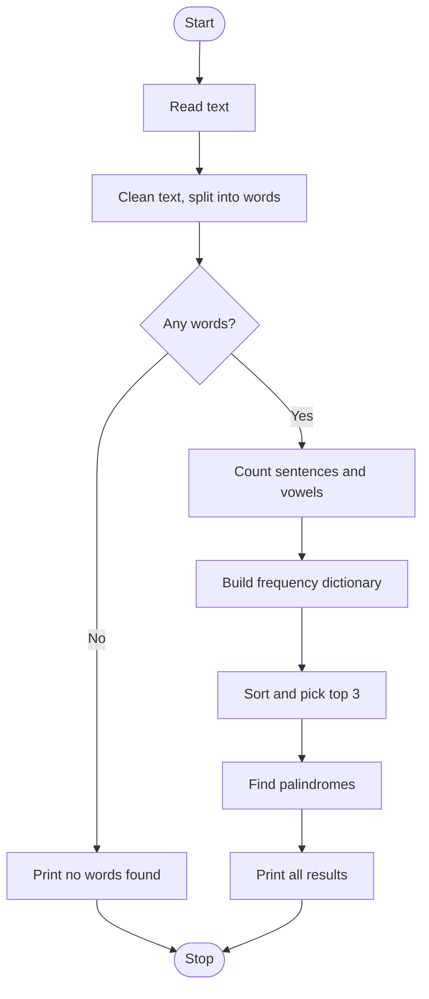

# Case Study 8: Text Analyzer

**Concepts used:** Strings, dictionaries, sets, sorting with keys, the string module

## 1. Problem Statement

Build a tool that reads a paragraph and reports statistics: number of words, unique words, sentences, vowels, the longest word, the 3 most frequent words and any palindrome words.

## 2. Objectives

1. Clean text by changing case and removing punctuation.
2. Count word frequency using a dictionary.
3. Sort items by more than one rule (count, then alphabet).
4. Use string slicing to detect palindromes.

## 3. Assumptions

- The text is entered on a single line in English.
- A sentence ends with ., ! or ?.
- Palindromes must have more than 2 letters.
- Words are separated by spaces.

## 4. Algorithm

1. Read the text.
2. Convert to lower case, remove punctuation and split into words; stop if no words.
3. Count sentences by counting . ! and ?
4. Build a frequency dictionary of the words.
5. Sort by count (highest first) and then alphabetically; take the top 3.
6. Count vowels in the text.
7. Find words longer than 2 letters that equal their reverse.
8. Print all results.

## 5. Pseudocode

```text
READ text
words = lowercase(text) without punctuation, split by spaces
IF words empty THEN PRINT 'No words found', STOP
sentences = count of '.', '!', '?'
FOR each word: freq[word] += 1
top3 = sort freq by (-count, word), first 3
vowels = count of a,e,i,o,u in text
palindromes = words with length > 2 and word = reverse(word)
PRINT all results
```

## 6. Flowchart

(GitHub draws this automatically. To get an image, take a screenshot of the rendered chart.)



## 7. Source Code

File: [`text_analyzer.py`](text_analyzer.py)

```python
"""Case Study 8: Text Analyzer (dictionaries, strings, sorting)."""
import string


def clean_words(text):
    """Lower-case the text, remove punctuation and split into words."""
    table = str.maketrans("", "", string.punctuation)
    return text.lower().translate(table).split()


def main():
    text = input("Enter text: ")
    words = clean_words(text)
    if not words:
        print("No words found.")
        return

    sentences = sum(text.count(p) for p in ".!?")
    freq = {}
    for w in words:
        freq[w] = freq.get(w, 0) + 1

    # sort by count (high first), then alphabetically
    top = sorted(freq.items(), key=lambda item: (-item[1], item[0]))[:3]
    vowels = sum(1 for ch in text.lower() if ch in "aeiou")
    palindromes = sorted({w for w in words if len(w) > 2 and w == w[::-1]})

    print("Total words:", len(words))
    print("Unique words:", len(freq))
    print("Sentences:", sentences)
    print("Vowels:", vowels)
    print("Longest word:", max(words, key=len))
    print("Top 3 words:", top)
    print("Palindromes:", palindromes if palindromes else "None")


main()
```

## 8. Test Cases

Run with `python text_analyzer.py`. Type the input values one per line, in the order shown (⏎ means press Enter).

| No. | Test description | Input (in order) | Expected output | Result |
|---|---|---|---|---|
| 1 | Mixed sentence with palindromes | `Madam saw a level car. Wow, level up!` | `Total words: 8`<br>`Unique words: 7`<br>`Sentences: 2`<br>`Vowels: 11`<br>`Longest word: madam`<br>`Top 3 words: [('level', 2), ('a', 1), ('car', 1)]`<br>`Palindromes: ['level', 'madam', 'wow']` | Pass |
| 2 | Only punctuation | `!!!` | `No words found.` | Pass |
| 3 | Ties sorted alphabetically | `to be or not to be.` | `Top 3 words: [('be', 2), ('to', 2), ('not', 1)]`<br>`Palindromes: None` | Pass |
| 4 | Single word | `hello` | `Total words: 1` | Pass |

## 9. Sample Output (take your screenshot of this run)

Input typed: `Madam saw a level car. Wow, level up!`

```text
Enter text: Total words: 8
Unique words: 7
Sentences: 2
Vowels: 11
Longest word: madam
Top 3 words: [('level', 2), ('a', 1), ('car', 1)]
Palindromes: ['level', 'madam', 'wow']
```

*Add your own screenshot here:* ``

## 10. Conclusion

The analyzer gives accurate statistics for different texts. Dictionaries made word counting simple, and sorting with a tuple key handled ties neatly. It could be extended to read text from a file or ignore common words such as 'the'.
