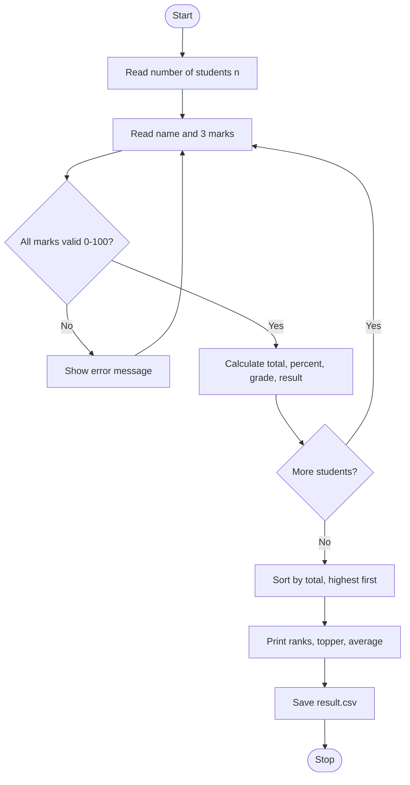

# Case Study 3: Student Result Management System

**Concepts used:** Lists, input validation, sorting with lambda, CSV file handling

## 1. Problem Statement

A department wants to process marks of students in 3 subjects. For each student the program must calculate the total, percentage, grade and pass/fail result, rank the students, find the topper and class average, and save the report as a CSV file.

## 2. Objectives

1. Read and validate marks (0 to 100) using loops and exceptions.
2. Compute total, percentage and grade using functions.
3. Sort students by total marks to assign ranks.
4. Write the final report to a CSV file.

## 3. Assumptions

- Each student has exactly 3 subjects, each out of 100.
- A student fails if marks in any subject are below 40.
- Grades: 90+ is A+, 75+ is A, 60+ is B, 40+ is C, else F.
- Student names are entered as single words.

## 4. Algorithm

1. Read the number of students n.
2. For each student read the name and 3 marks; repeat until all marks are valid numbers from 0 to 100.
3. Calculate total, percentage (total / 3), grade and result.
4. Sort the student list by total, highest first.
5. Print rank, name, total, percentage, grade and result.
6. Print the topper (first in sorted list) and class average.
7. Write all rows to result.csv.

## 5. Pseudocode

```text
READ n
FOR each student
    READ name
    REPEAT READ 3 marks UNTIL all are numbers between 0 and 100
    total = sum of marks; percent = total / 3
    grade = getGrade(percent)
    result = FAIL if smallest mark < 40 else PASS
    ADD record to list
SORT list by total descending
PRINT each record with rank
PRINT topper and average
WRITE list to result.csv
```

## 6. Flowchart

(GitHub draws this automatically. To get an image, take a screenshot of the rendered chart.)



## 7. Source Code

File: [`result_management.py`](result_management.py)

```python
"""Case Study 3: Student Result Management System (saves a CSV report)."""
import csv

SUBJECTS = 3


def get_grade(percent):
    """Return a grade letter for a percentage."""
    if percent >= 90:
        return "A+"
    if percent >= 75:
        return "A"
    if percent >= 60:
        return "B"
    if percent >= 40:
        return "C"
    return "F"


def read_marks(name):
    """Keep asking until 3 valid marks (0-100) are entered."""
    while True:
        parts = input("Marks of " + name + " (3 subjects): ").split()
        try:
            marks = [int(p) for p in parts]
            if len(marks) == SUBJECTS and all(0 <= m <= 100 for m in marks):
                return marks
        except ValueError:
            pass
        print("Invalid marks. Enter 3 numbers between 0 and 100.")


def main():
    n = int(input("Number of students: "))
    students = []
    for _ in range(n):
        name = input("Student name: ")
        marks = read_marks(name)
        total = sum(marks)
        percent = round(total / SUBJECTS, 2)
        result = "FAIL" if min(marks) < 40 else "PASS"   # fail if any subject < 40
        students.append([name, total, percent, get_grade(percent), result])

    students.sort(key=lambda s: s[1], reverse=True)       # highest total first
    print("\nRank Name Total Percent Grade Result")
    for rank, s in enumerate(students, start=1):
        print(rank, s[0], s[1], s[2], s[3], s[4])

    average = sum(s[1] for s in students) / n
    print("Topper:", students[0][0])
    print("Class average total:", round(average, 2))

    with open("result.csv", "w", newline="") as f:
        writer = csv.writer(f)
        writer.writerow(["Name", "Total", "Percent", "Grade", "Result"])
        writer.writerows(students)
    print("Report saved to result.csv")


main()
```

## 8. Test Cases

Run with `python result_management.py`. Type the input values one per line, in the order shown (⏎ means press Enter).

| No. | Test description | Input (in order) | Expected output | Result |
|---|---|---|---|---|
| 1 | Two students, one passes and one fails | `2 ⏎ Asha ⏎ 90 85 95 ⏎ Ravi ⏎ 50 30 70` | `1 Asha 270 90.0 A+ PASS`<br>`2 Ravi 150 50.0 C FAIL`<br>`Topper: Asha`<br>`Class average total: 210.0` | Pass |
| 2 | Marks above 100 are rejected | `1 ⏎ Asha ⏎ 120 50 50 ⏎ 80 70 90` | `Invalid marks. Enter 3 numbers between 0 and 100.` | Pass |
| 3 | Re-entered valid marks accepted | `1 ⏎ Asha ⏎ 120 50 50 ⏎ 80 70 90` | `1 Asha 240 80.0 A PASS` | Pass |
| 4 | Boundary: exactly 40 in all subjects | `1 ⏎ Tom ⏎ 40 40 40` | `1 Tom 120 40.0 C PASS` | Pass |
| 5 | Non-numeric marks are rejected | `1 ⏎ Tom ⏎ abc 50 60 ⏎ 50 50 50` | `Invalid marks. Enter 3 numbers between 0 and 100.` | Pass |
| 6 | CSV report is written | `1 ⏎ Tom ⏎ 50 50 50` | `Report saved to result.csv` | Pass |

## 9. Sample Output (take your screenshot of this run)

Input typed: `2 ⏎ Asha ⏎ 90 85 95 ⏎ Ravi ⏎ 50 30 70`

```text
Number of students: Student name: Marks of Asha (3 subjects): Student name: Marks of Ravi (3 subjects): 
Rank Name Total Percent Grade Result
1 Asha 270 90.0 A+ PASS
2 Ravi 150 50.0 C FAIL
Topper: Asha
Class average total: 210.0
Report saved to result.csv
```

*Add your own screenshot here:* ``

## 10. Conclusion

The program processes results accurately, rejects bad data and produces a ranked report plus a CSV file that can be opened in Excel. Sorting with a lambda function made ranking very short to code. Subject names and more subjects could be added later.
