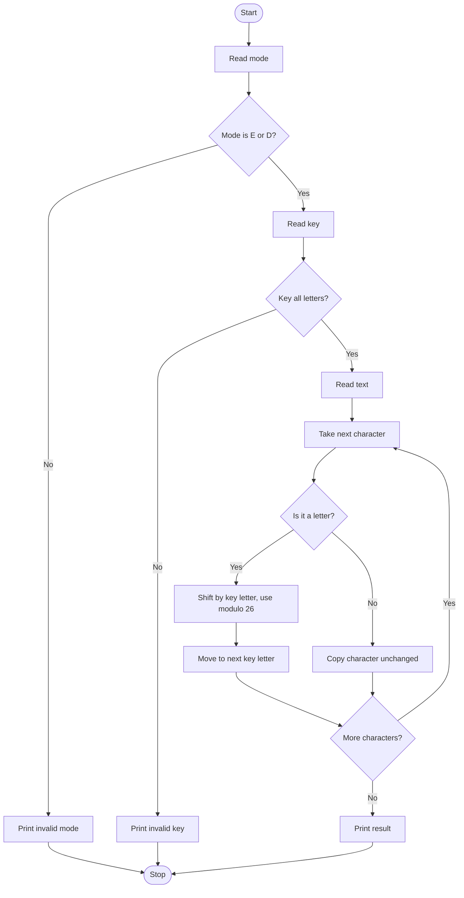

# Case Study 10: Vigenere Cipher Encryption and Decryption Tool

**Concepts used:** Strings, ASCII/Unicode values (ord, chr), modulo arithmetic, loops

## 1. Problem Statement

Build a tool that encrypts and decrypts messages using the Vigenere cipher. A keyword decides how far each letter is shifted. Upper and lower case must be preserved and spaces, digits and symbols must stay unchanged.

## 2. Objectives

1. Convert letters to numbers and back using ord() and chr().
2. Use modulo 26 to wrap around the alphabet.
3. Repeat the key over the text, using key letters only for letters.
4. Validate the mode and the key.

## 3. Assumptions

- The key contains only letters; its case does not matter.
- Only English letters A-Z are shifted.
- Non-letters are copied without using up a key letter.

## 4. Algorithm

1. Read the mode (E or D); stop if invalid.
2. Read the key; stop if it is not alphabetic.
3. Read the text.
4. For each character: if it is a letter, find its alphabet position, get the shift from the next key letter, add the shift (encrypt) or subtract it (decrypt), apply modulo 26 and keep the original case.
5. Move to the next key letter only after a letter.
6. Copy any other character as it is; print the result.

## 5. Pseudocode

```text
READ mode, key, text
IF mode not E or D THEN error
IF key not all letters THEN error
k = 0; result = empty
FOR each ch in text
    IF ch is a letter THEN
        base = 'A' if uppercase else 'a'
        shift = position of key[k mod length of key]
        IF encrypt THEN new = (ch - base + shift) mod 26
        ELSE new = (ch - base - shift) mod 26
        append new letter; k = k + 1
    ELSE append ch
PRINT result
```

## 6. Flowchart

(GitHub draws this automatically. To get an image, take a screenshot of the rendered chart.)



## 7. Source Code

File: [`vigenere_cipher.py`](vigenere_cipher.py)

```python
"""Case Study 10: Vigenere Cipher Encryption and Decryption Tool."""


def shift_text(text, key, direction):
    """direction = +1 to encrypt, -1 to decrypt. Non-letters are kept as they are."""
    result = ""
    k = 0                                          # position in the key
    for ch in text:
        if ch.isalpha():
            base = ord("A") if ch.isupper() else ord("a")
            shift = ord(key[k % len(key)].lower()) - ord("a")
            result += chr((ord(ch) - base + direction * shift) % 26 + base)
            k += 1                                 # only letters use up key letters
        else:
            result += ch
    return result


def main():
    mode = input("Encrypt or Decrypt (E/D): ").strip().upper()
    if mode not in ("E", "D"):
        print("Invalid mode.")
        return
    key = input("Key (letters only): ").strip()
    if not key.isalpha():
        print("Invalid key. Use letters only.")
        return
    text = input("Text: ")
    print("Result:", shift_text(text, key, 1 if mode == "E" else -1))


main()
```

## 8. Test Cases

Run with `python vigenere_cipher.py`. Type the input values one per line, in the order shown (⏎ means press Enter).

| No. | Test description | Input (in order) | Expected output | Result |
|---|---|---|---|---|
| 1 | Encrypt HELLO with key KEY | `E ⏎ KEY ⏎ HELLO` | `Result: RIJVS` | Pass |
| 2 | Decrypt RIJVS with key KEY | `D ⏎ KEY ⏎ RIJVS` | `Result: HELLO` | Pass |
| 3 | Mixed case, spaces and symbol | `E ⏎ LEMON ⏎ Attack at Dawn!` | `Result: Lxfopv ef Rnhr!` | Pass |
| 4 | Key contains a digit | `E ⏎ key1 ⏎ Hello` | `Invalid key. Use letters only.` | Pass |
| 5 | Invalid mode | `X` | `Invalid mode.` | Pass |
| 6 | Lower-case key gives same result | `E ⏎ key ⏎ HELLO` | `Result: RIJVS` | Pass |

## 9. Sample Output (take your screenshot of this run)

Input typed: `E ⏎ KEY ⏎ HELLO`

```text
Encrypt or Decrypt (E/D): Key (letters only): Text: Result: RIJVS
```

*Add your own screenshot here:* ``

## 10. Conclusion

The tool encrypts and decrypts correctly and decrypting an encrypted message always returns the original text. Using modulo 26 handles wrap-around from Z to A. It shows how simple mathematics can protect text, although the Vigenere cipher is not secure by modern standards.
