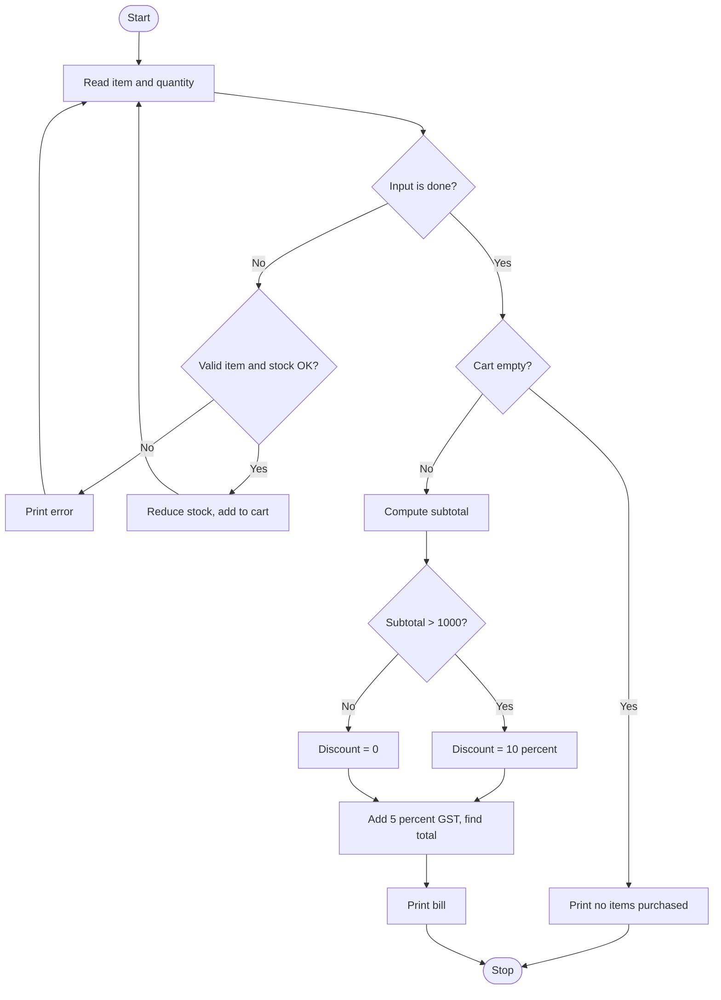

# Case Study 4: Supermarket Billing and Inventory System

**Concepts used:** Dictionaries, loops, string handling, conditional pricing

## 1. Problem Statement

A supermarket needs a billing program that checks stock, lets a customer buy items by name and quantity, reduces the stock, and prints a bill. If the subtotal is above 1000 a 10% discount is given, and 5% GST is added on the amount after discount.

## 2. Objectives

1. Store item prices and stock in a dictionary.
2. Validate item names and quantities against available stock.
3. Update stock after every purchase.
4. Calculate discount, GST and the final total correctly.

## 3. Assumptions

- Prices are per unit in rupees.
- Stock is fixed in the program at start.
- Discount applies only when subtotal is strictly greater than 1000.
- GST is charged on the discounted amount.

## 4. Algorithm

1. Display the available items.
2. Read lines in the form 'item quantity' until the user types done.
3. Reject wrong format, unknown items and quantities more than the stock.
4. For valid lines reduce stock and add quantity to the cart.
5. If the cart is empty print a message and stop.
6. Subtotal = sum of price x quantity.
7. If subtotal > 1000 then discount = 10% of subtotal.
8. GST = 5% of (subtotal - discount); Total = subtotal - discount + GST.
9. Print the bill.

## 5. Pseudocode

```text
inventory = {item: [price, stock]}
cart = empty
LOOP
    READ line; IF line = done THEN BREAK
    IF wrong format THEN message, CONTINUE
    IF item not in inventory THEN message
    ELSE IF qty <= 0 OR qty > stock THEN message
    ELSE stock -= qty; cart[item] += qty
END LOOP
IF cart empty THEN PRINT message, STOP
subtotal = SUM(price * qty)
discount = 10% of subtotal IF subtotal > 1000 ELSE 0
tax = 5% of (subtotal - discount)
total = subtotal - discount + tax
PRINT bill
```

## 6. Flowchart

(GitHub draws this automatically. To get an image, take a screenshot of the rendered chart.)



## 7. Source Code

File: [`billing_system.py`](billing_system.py)

```python
"""Case Study 4: Supermarket Billing and Inventory System."""

# item: [price per unit, stock available]
inventory = {
    "rice": [60, 20],
    "sugar": [45, 10],
    "oil": [150, 5],
    "tea": [250, 8],
}
GST_RATE = 0.05          # 5% tax
DISCOUNT_LIMIT = 1000    # discount applies above this subtotal
DISCOUNT_RATE = 0.10     # 10% discount


def main():
    cart = {}
    print("Items:", ", ".join(inventory))
    print("Enter 'item quantity' (or 'done' to finish)")
    while True:
        line = input("> ").strip().lower()
        if line == "done":
            break
        parts = line.split()
        if len(parts) != 2 or not parts[1].isdigit():
            print("Format: item quantity")
            continue
        item, qty = parts[0], int(parts[1])
        if item not in inventory:
            print("Item not available.")
        elif qty <= 0 or qty > inventory[item][1]:
            print("Only", inventory[item][1], "in stock.")
        else:
            inventory[item][1] -= qty                  # reduce stock
            cart[item] = cart.get(item, 0) + qty
            print("Added", qty, item)

    if not cart:
        print("No items purchased.")
        return

    print("\n----- BILL -----")
    subtotal = 0
    for item, qty in cart.items():
        cost = inventory[item][0] * qty
        subtotal += cost
        print(item, qty, "x", inventory[item][0], "=", cost)
    discount = subtotal * DISCOUNT_RATE if subtotal > DISCOUNT_LIMIT else 0
    tax = (subtotal - discount) * GST_RATE
    total = subtotal - discount + tax
    print("Subtotal:", round(subtotal, 2))
    print("Discount:", round(discount, 2))
    print("GST 5%:", round(tax, 2))
    print("TOTAL:", round(total, 2))


main()
```

## 8. Test Cases

Run with `python billing_system.py`. Type the input values one per line, in the order shown (⏎ means press Enter).

| No. | Test description | Input (in order) | Expected output | Result |
|---|---|---|---|---|
| 1 | Small purchase, no discount | `rice 2 ⏎ sugar 1 ⏎ done` | `Subtotal: 165`<br>`GST 5%: 8.25`<br>`TOTAL: 173.25` | Pass |
| 2 | Subtotal exactly 1000 (no discount) | `tea 4 ⏎ done` | `TOTAL: 1050.0` | Pass |
| 3 | Subtotal above 1000 (discount applies) | `tea 5 ⏎ done` | `Discount: 125.0`<br>`TOTAL: 1181.25` | Pass |
| 4 | Quantity more than stock | `oil 6 ⏎ done` | `Only 5 in stock.` | Pass |
| 5 | Item not in inventory | `milk 1 ⏎ done` | `Item not available.` | Pass |
| 6 | Wrong input format | `rice ⏎ done` | `Format: item quantity` | Pass |
| 7 | Nothing bought | `done` | `No items purchased.` | Pass |

## 9. Sample Output (take your screenshot of this run)

Input typed: `rice 2 ⏎ sugar 1 ⏎ done`

```text
Items: rice, sugar, oil, tea
Enter 'item quantity' (or 'done' to finish)
> Added 2 rice
> Added 1 sugar
> 
----- BILL -----
rice 2 x 60 = 120
sugar 1 x 45 = 45
Subtotal: 165
Discount: 0
GST 5%: 8.25
TOTAL: 173.25
```

*Add your own screenshot here:* ``

## 10. Conclusion

The billing system gives correct totals for all price ranges, protects stock levels and rejects wrong input. Keeping rates as named constants (GST_RATE, DISCOUNT_RATE) makes the rules easy to change. A future version could load stock from a file.
