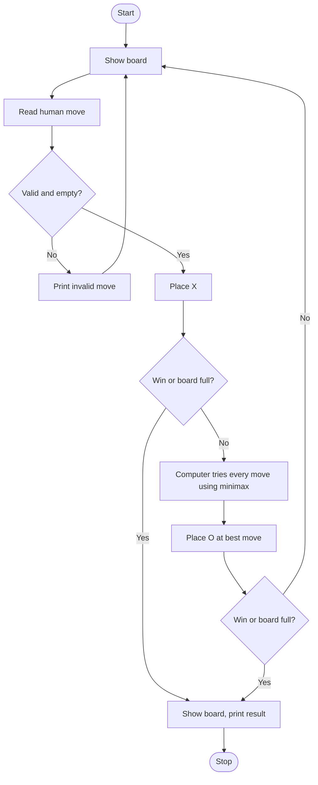

# Case Study 5: Tic-Tac-Toe against an Unbeatable Computer (Minimax)

**Concepts used:** Lists, functions, recursion, the Minimax algorithm

## 1. Problem Statement

Create a Tic-Tac-Toe game where a human (X) plays against the computer (O). The computer must choose its moves using the Minimax algorithm so that it never loses; the best the human can achieve is a draw.

## 2. Objectives

1. Represent the board as a list and detect wins using winning lines.
2. Use recursion to explore all possible future moves.
3. Implement Minimax to score positions (+1 computer win, 0 draw, -1 human win).
4. Validate the human's moves.

## 3. Assumptions

- Human always plays first as X.
- Positions are numbered 1 to 9, left to right, top to bottom.
- If several moves have the same score, the first one is chosen.

## 4. Algorithm

1. Start with an empty board of 9 cells.
2. Show the board and read the human move; reject invalid or occupied cells.
3. After each move check for a win or a full board.
4. For the computer: try every empty cell, call minimax on the resulting board, and pick the cell with the highest score.
5. minimax returns +1, -1 or 0 at the end of a game; otherwise it tries all moves for the current player and returns the max (computer turn) or the min (human turn).
6. Repeat until someone wins or the board is full; print the result.

## 5. Pseudocode

```text
FUNCTION minimax(board, computerTurn)
    IF O has won RETURN +1
    IF X has won RETURN -1
    IF board full RETURN 0
    FOR each empty cell
        place the current player's mark
        score = minimax(board, NOT computerTurn)
        remove the mark
    IF computerTurn RETURN max(scores) ELSE RETURN min(scores)

FUNCTION computerMove(board)
    best = -2
    FOR each empty cell: place O, score = minimax(board, false), undo
        IF score > best THEN best = score, move = cell
    RETURN move

MAIN: LOOP human move, check end, computerMove, check end; PRINT result
```

## 6. Flowchart

(GitHub draws this automatically. To get an image, take a screenshot of the rendered chart.)



## 7. Source Code

File: [`tictactoe_ai.py`](tictactoe_ai.py)

```python
"""Case Study 5: Tic-Tac-Toe against an unbeatable computer (Minimax algorithm)."""

WIN_LINES = [(0, 1, 2), (3, 4, 5), (6, 7, 8),     # rows
             (0, 3, 6), (1, 4, 7), (2, 5, 8),     # columns
             (0, 4, 8), (2, 4, 6)]                # diagonals


def show(board):
    for i in range(0, 9, 3):
        print(" | ".join(board[i:i + 3]))
        if i < 6:
            print("--+---+--")


def winner(board):
    """Return 'X' or 'O' if someone has won, else None."""
    for a, b, c in WIN_LINES:
        if board[a] == board[b] == board[c] != " ":
            return board[a]
    return None


def minimax(board, is_computer):
    """Score a position: +1 computer wins, -1 human wins, 0 draw."""
    w = winner(board)
    if w == "O":
        return 1
    if w == "X":
        return -1
    if " " not in board:
        return 0
    scores = []
    for i in range(9):
        if board[i] == " ":
            board[i] = "O" if is_computer else "X"   # try the move
            scores.append(minimax(board, not is_computer))
            board[i] = " "                           # undo the move
    return max(scores) if is_computer else min(scores)


def computer_move(board):
    """Pick the move with the best minimax score (first one wins ties)."""
    best_score, best_move = -2, None
    for i in range(9):
        if board[i] == " ":
            board[i] = "O"
            score = minimax(board, False)
            board[i] = " "
            if score > best_score:
                best_score, best_move = score, i
    return best_move


def main():
    board = [" "] * 9
    print("You are X, computer is O. Positions are 1-9 (left to right, top to bottom).")
    while True:
        show(board)
        pos = input("Your move (1-9): ").strip()
        if not pos.isdigit() or not 1 <= int(pos) <= 9 or board[int(pos) - 1] != " ":
            print("Invalid move, try again.")
            continue
        board[int(pos) - 1] = "X"
        if winner(board) or " " not in board:
            break
        board[computer_move(board)] = "O"
        print("Computer played.")
        if winner(board) or " " not in board:
            break
    show(board)
    w = winner(board)
    print("You win!" if w == "X" else "Computer wins!" if w == "O" else "It's a draw!")


main()
```

## 8. Test Cases

Run with `python tictactoe_ai.py`. Type the input values one per line, in the order shown (⏎ means press Enter).

| No. | Test description | Input (in order) | Expected output | Result |
|---|---|---|---|---|
| 1 | Human plays badly (1, 2, 4) | `1 ⏎ 2 ⏎ 4` | `Computer wins!` | Pass |
| 2 | Human plays well (1, 2, 7, 6, 9) | `1 ⏎ 2 ⏎ 7 ⏎ 6 ⏎ 9` | `It's a draw!` | Pass |
| 3 | Invalid cell number 0, then a repeated cell | `0 ⏎ 1 ⏎ 1 ⏎ 2 ⏎ 7 ⏎ 6 ⏎ 9` | `Invalid move, try again.` | Pass |
| 4 | Non-numeric input | `abc ⏎ 1 ⏎ 2 ⏎ 7 ⏎ 6 ⏎ 9` | `Invalid move, try again.` | Pass |
| 5 | Computer reply shown after human move | `1 ⏎ 2 ⏎ 4` | `Computer played.` | Pass |

## 9. Sample Output (take your screenshot of this run)

Input typed: `1 ⏎ 2 ⏎ 4`

```text
You are X, computer is O. Positions are 1-9 (left to right, top to bottom).
  |   |  
--+---+--
  |   |  
--+---+--
  |   |  
Your move (1-9): Computer played.
X |   |  
--+---+--
  | O |  
--+---+--
  |   |  
Your move (1-9): Computer played.
X | X | O
--+---+--
  | O |  
--+---+--
  |   |  
Your move (1-9): Computer played.
X | X | O
--+---+--
X | O |  
--+---+--
O |   |  
Computer wins!
```

*Add your own screenshot here:* ``

## 10. Conclusion

Minimax lets the computer evaluate every possible continuation, so it never loses. Tests show a careless human loses and a careful one can only draw. The program is a good example of recursion with backtracking (place a mark, explore, undo it).
