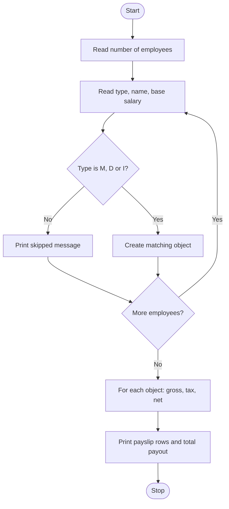

# Case Study 9: Employee Payroll System

**Concepts used:** Object-oriented programming: classes, inheritance, polymorphism, method overriding

## 1. Problem Statement

A company has Managers, Developers and Interns, each with a different salary structure. Create a payroll program that calculates gross salary, tax and net salary for each employee and prints the total payout. Tax is charged on a slab basis except for interns.

## 2. Objectives

1. Create a base class Employee and child classes Manager, Developer and Intern.
2. Override methods to give different salary rules (polymorphism).
3. Calculate tax using slabs.
4. Print a payslip table and total payout.

## 3. Assumptions

- Manager gross = base + 20% allowance + 10000 bonus.
- Developer gross = base + 10% allowance.
- Intern gross = base (stipend) and pays no tax.
- Tax slabs on gross: up to 30000 is 0%, up to 60000 is 10%, above 60000 is 20%.

## 4. Algorithm

1. Read the number of employees.
2. For each employee read the type (M, D or I), the name and the base salary; skip unknown types.
3. Create an object of the matching class.
4. For every object call gross_salary(), tax() and net_salary(); each class applies its own rules.
5. Print one row per employee and add the net salary to the total.
6. Print the total payout.

## 5. Pseudocode

```text
CLASS Employee: gross = base; tax by slab; net = gross - tax
CLASS Manager EXTENDS Employee: gross = base*1.2 + 10000
CLASS Developer EXTENDS Employee: gross = base*1.1
CLASS Intern EXTENDS Employee: tax = 0

READ n
FOR each employee
    READ type, name, base
    IF type unknown THEN skip
    CREATE object of matching class
FOR each object
    PRINT name, role, gross, tax, net
    total += net
PRINT total
```

## 6. Flowchart

(GitHub draws this automatically. To get an image, take a screenshot of the rendered chart.)



## 7. Source Code

File: [`payroll_system.py`](payroll_system.py)

```python
"""Case Study 9: Employee Payroll System (inheritance and polymorphism)."""


class Employee:
    def __init__(self, name, base):
        self.name = name
        self.base = base

    def gross_salary(self):
        return self.base

    def tax(self):
        """Tax slab on gross salary: up to 30000 -> 0%, up to 60000 -> 10%, above -> 20%."""
        gross = self.gross_salary()
        if gross <= 30000:
            return 0
        if gross <= 60000:
            return gross * 0.10
        return gross * 0.20

    def net_salary(self):
        return self.gross_salary() - self.tax()

    def role(self):
        return "Employee"


class Manager(Employee):
    def gross_salary(self):                       # base + 20% allowance + 10000 bonus
        return self.base * 1.20 + 10000

    def role(self):
        return "Manager"


class Developer(Employee):
    def gross_salary(self):                       # base + 10% allowance
        return self.base * 1.10

    def role(self):
        return "Developer"


class Intern(Employee):
    def tax(self):                                # interns pay no tax
        return 0

    def role(self):
        return "Intern"


def main():
    kinds = {"M": Manager, "D": Developer, "I": Intern}
    n = int(input("Number of employees: "))
    staff = []
    for _ in range(n):
        kind = input("Type (M/D/I): ").strip().upper()
        if kind not in kinds:
            print("Unknown type, employee skipped.")
            input("Name: "); input("Base salary: ")   # read and ignore
            continue
        name = input("Name: ")
        base = float(input("Base salary: "))
        staff.append(kinds[kind](name, base))

    total = 0
    print("\nName | Role | Gross | Tax | Net")
    for e in staff:                                  # same call, different behaviour
        print(e.name, "|", e.role(), "|", round(e.gross_salary(), 2), "|",
              round(e.tax(), 2), "|", round(e.net_salary(), 2))
        total += e.net_salary()
    print("Total payout:", round(total, 2))


main()
```

## 8. Test Cases

Run with `python payroll_system.py`. Type the input values one per line, in the order shown (⏎ means press Enter).

| No. | Test description | Input (in order) | Expected output | Result |
|---|---|---|---|---|
| 1 | One of each type | `3 ⏎ M ⏎ Asha ⏎ 50000 ⏎ D ⏎ Ravi ⏎ 40000 ⏎ I ⏎ Kiran ⏎ 15000` | `Asha \| Manager \| 70000.0 \| 14000.0 \| 56000.0`<br>`Ravi \| Developer \| 44000.0 \| 4400.0 \| 39600.0`<br>`Kiran \| Intern \| 15000.0 \| 0 \| 15000.0`<br>`Total payout: 110600.0` | Pass |
| 2 | Unknown employee type | `1 ⏎ X ⏎ Joe ⏎ 1000` | `Unknown type, employee skipped.` | Pass |
| 3 | Gross below 30000 pays no tax | `1 ⏎ D ⏎ Ravi ⏎ 25000` | `Ravi \| Developer \| 27500.0 \| 0 \| 27500.0` | Pass |
| 4 | Intern with high stipend pays no tax | `1 ⏎ I ⏎ Meena ⏎ 70000` | `Meena \| Intern \| 70000.0 \| 0 \| 70000.0` | Pass |

## 9. Sample Output (take your screenshot of this run)

Input typed: `3 ⏎ M ⏎ Asha ⏎ 50000 ⏎ D ⏎ Ravi ⏎ 40000 ⏎ I ⏎ Kiran ⏎ 15000`

```text
Number of employees: Type (M/D/I): Name: Base salary: Type (M/D/I): Name: Base salary: Type (M/D/I): Name: Base salary: 
Name | Role | Gross | Tax | Net
Asha | Manager | 70000.0 | 14000.0 | 56000.0
Ravi | Developer | 44000.0 | 4400.0 | 39600.0
Kiran | Intern | 15000.0 | 0 | 15000.0
Total payout: 110600.0
```

*Add your own screenshot here:* ``

## 10. Conclusion

Inheritance avoided repeating code: the tax logic lives once in Employee, and each subclass overrides only what is different. The same loop works for all employee types thanks to polymorphism, and new roles can be added without changing the main program.
