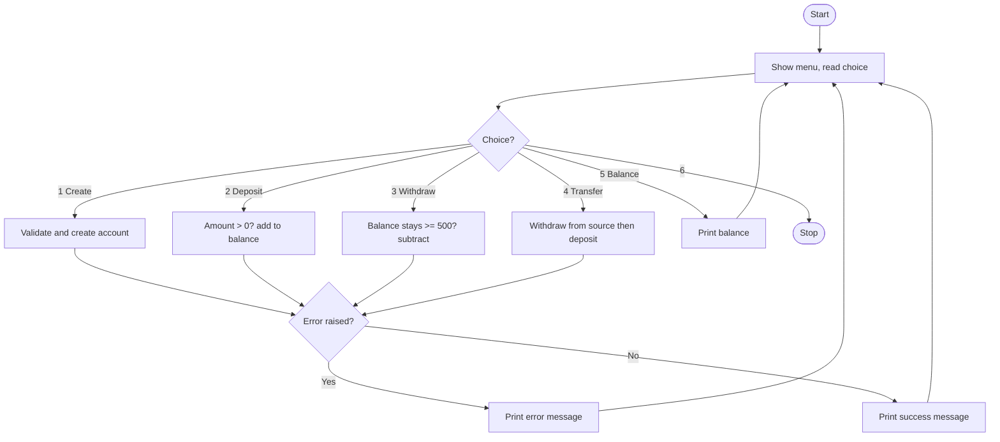

# Case Study 2: Banking System with Exception Handling

**Concepts used:** Classes and objects, custom exceptions, try/except, dictionaries

## 1. Problem Statement

Develop a simple banking application where customers can create accounts, deposit, withdraw, transfer money and check balances. Every account must always keep a minimum balance of 500. The program must not crash on wrong input; it must show clear error messages instead.

## 2. Objectives

1. Model an account using a class with deposit and withdraw methods.
2. Create a custom exception (InsufficientFundsError).
3. Use try/except to handle wrong account numbers and invalid amounts.
4. Implement a safe money transfer between two accounts.

## 3. Assumptions

- Account numbers are unique text values.
- Amounts are decimal numbers.
- Minimum balance is 500 (also required when opening).
- Data is kept in memory only for one run.

## 4. Algorithm

1. Show menu and read choice inside a try block.
2. Create: reject duplicate account numbers and opening balance below 500.
3. Deposit: amount must be positive; add to balance.
4. Withdraw: amount must be positive and balance after withdrawal must stay at least 500.
5. Transfer: withdraw from the source first; only if it succeeds deposit into the destination.
6. Any KeyError, ValueError or InsufficientFundsError is caught and an error message printed.
7. Exit on choice 6.

## 5. Pseudocode

```text
accounts = empty dictionary
LOOP forever
    READ choice
    TRY
        IF create THEN check duplicate and opening balance, add account
        IF deposit THEN IF amount <= 0 raise error ELSE balance += amount
        IF withdraw THEN
            IF amount <= 0 raise error
            IF balance - amount < 500 raise InsufficientFundsError
            balance -= amount
        IF transfer THEN withdraw from source, THEN deposit to destination
        IF balance THEN print balance
        IF exit THEN STOP
    CATCH KeyError, ValueError, InsufficientFundsError
        PRINT error message
END LOOP
```

## 6. Flowchart

(GitHub draws this automatically. To get an image, take a screenshot of the rendered chart.)



## 7. Source Code

File: [`bank_system.py`](bank_system.py)

```python
"""Case Study 2: Banking System with exception handling."""


class InsufficientFundsError(Exception):
    """Raised when a withdrawal would break the minimum balance rule."""


class Account:
    MIN_BALANCE = 500   # balance that must always remain in the account

    def __init__(self, acc_no, name, balance):
        self.acc_no = acc_no
        self.name = name
        self.balance = balance

    def deposit(self, amount):
        if amount <= 0:
            raise ValueError("Amount must be positive.")
        self.balance += amount

    def withdraw(self, amount):
        if amount <= 0:
            raise ValueError("Amount must be positive.")
        if self.balance - amount < Account.MIN_BALANCE:
            raise InsufficientFundsError("Minimum balance of 500 must remain.")
        self.balance -= amount


def main():
    accounts = {}
    while True:
        print("\n1.Create 2.Deposit 3.Withdraw 4.Transfer 5.Balance 6.Exit")
        choice = input("Enter choice: ").strip()
        try:
            if choice == "1":
                acc_no = input("Account no: ")
                if acc_no in accounts:
                    raise KeyError("Account already exists.")
                bal = float(input("Opening balance: "))
                if bal < Account.MIN_BALANCE:
                    raise ValueError("Opening balance must be at least 500.")
                accounts[acc_no] = Account(acc_no, input("Name: "), bal)
                print("Account created.")
            elif choice == "2":
                acc = accounts[input("Account no: ")]
                acc.deposit(float(input("Amount: ")))
                print("Deposited. New balance:", acc.balance)
            elif choice == "3":
                acc = accounts[input("Account no: ")]
                acc.withdraw(float(input("Amount: ")))
                print("Withdrawn. New balance:", acc.balance)
            elif choice == "4":
                src = accounts[input("From account: ")]
                dst = accounts[input("To account: ")]
                amount = float(input("Amount: "))
                src.withdraw(amount)     # fails first if funds are short
                dst.deposit(amount)
                print("Transfer successful.")
            elif choice == "5":
                acc = accounts[input("Account no: ")]
                print(acc.name, "balance:", acc.balance)
            elif choice == "6":
                print("Thank you!")
                break
            else:
                print("Invalid choice.")
        except KeyError:
            print("Error: Account not found or already exists.")
        except InsufficientFundsError as e:
            print("Error:", e)
        except ValueError as e:
            print("Error:", e)


main()
```

## 8. Test Cases

Run with `python bank_system.py`. Type the input values one per line, in the order shown (⏎ means press Enter).

| No. | Test description | Input (in order) | Expected output | Result |
|---|---|---|---|---|
| 1 | Create account and deposit 500 | `1 ⏎ 101 ⏎ 1000 ⏎ Asha ⏎ 2 ⏎ 101 ⏎ 500 ⏎ 6` | `Deposited. New balance: 1500.0` | Pass |
| 2 | Withdraw within limit | `1 ⏎ 101 ⏎ 1000 ⏎ Asha ⏎ 3 ⏎ 101 ⏎ 400 ⏎ 6` | `Withdrawn. New balance: 600.0` | Pass |
| 3 | Withdraw breaking minimum balance | `1 ⏎ 101 ⏎ 1000 ⏎ Asha ⏎ 3 ⏎ 101 ⏎ 700 ⏎ 6` | `Error: Minimum balance of 500 must remain.` | Pass |
| 4 | Transfer between two accounts | `1 ⏎ 101 ⏎ 2000 ⏎ A ⏎ 1 ⏎ 102 ⏎ 1000 ⏎ B ⏎ 4 ⏎ 101 ⏎ 102 ⏎ 500 ⏎ 5 ⏎ 102 ⏎ 6` | `Transfer successful.`<br>`B balance: 1500.0` | Pass |
| 5 | Negative deposit | `1 ⏎ 101 ⏎ 1000 ⏎ Asha ⏎ 2 ⏎ 101 ⏎ -50 ⏎ 6` | `Error: Amount must be positive.` | Pass |
| 6 | Unknown account number | `2 ⏎ 999 ⏎ 100 ⏎ 6` | `Error: Account not found or already exists.` | Pass |
| 7 | Opening balance too low | `1 ⏎ 101 ⏎ 100 ⏎ 6` | `Error: Opening balance must be at least 500.` | Pass |

## 9. Sample Output (take your screenshot of this run)

Input typed: `1 ⏎ 101 ⏎ 1000 ⏎ Asha ⏎ 2 ⏎ 101 ⏎ 500 ⏎ 6`

```text

1.Create 2.Deposit 3.Withdraw 4.Transfer 5.Balance 6.Exit
Enter choice: Account no: Opening balance: Name: Account created.

1.Create 2.Deposit 3.Withdraw 4.Transfer 5.Balance 6.Exit
Enter choice: Account no: Amount: Deposited. New balance: 1500.0

1.Create 2.Deposit 3.Withdraw 4.Transfer 5.Balance 6.Exit
Enter choice: Thank you!
```

*Add your own screenshot here:* ``

## 10. Conclusion

The system handles normal and faulty inputs without crashing. A class keeps account data and rules together, and the custom exception makes the minimum balance rule clear. The transfer withdraws first so money is never created or lost if a step fails.
