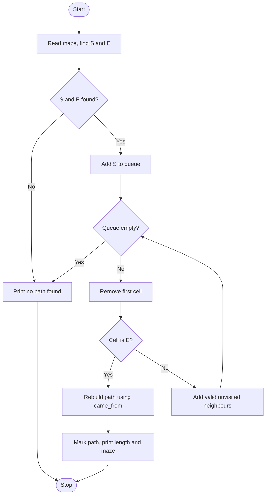

# Case Study 7: Maze Solver using Breadth-First Search

**Concepts used:** 2D lists, queues (deque), dictionaries, BFS, path reconstruction

## 1. Problem Statement

Given a maze drawn with characters ('S' start, 'E' end, '#' wall, '.' open path), find the shortest path from S to E and display it with '*' marks. If no path exists, print a message.

## 2. Objectives

1. Read a grid from the user and locate S and E.
2. Use a queue to implement Breadth-First Search.
3. Rebuild the path using a came_from dictionary.
4. Handle mazes with no solution.

## 3. Assumptions

- Movement is up, down, left or right only (no diagonals).
- The maze is rectangular and has at most one S and one E.
- Each move costs one step.

## 4. Algorithm

1. Read the number of rows and the maze rows.
2. Find the positions of S and E; if either is missing, there is no path.
3. Put S in a queue and record came_from[S] = None.
4. Remove a cell from the queue; if it is E, rebuild the path backwards using came_from.
5. Otherwise visit its 4 neighbours that are inside the grid, are not walls and are not yet visited; record where they came from and add them to the queue.
6. If the queue becomes empty, no path exists.
7. Mark the path with * and print the length and the maze.

## 5. Pseudocode

```text
FIND start, end
queue = [start]; cameFrom[start] = none
WHILE queue not empty
    cell = remove first from queue
    IF cell = end THEN
        walk back using cameFrom to build path
        RETURN reversed path
    FOR each neighbour (up, down, left, right)
        IF inside grid AND not wall AND not visited THEN
            cameFrom[neighbour] = cell
            ADD neighbour to queue
RETURN no path
```

## 6. Flowchart

(GitHub draws this automatically. To get an image, take a screenshot of the rendered chart.)



## 7. Source Code

File: [`maze_solver.py`](maze_solver.py)

```python
"""Case Study 7: Maze Solver using Breadth-First Search (shortest path)."""
from collections import deque


def find(maze, symbol):
    """Return (row, col) of a symbol in the maze."""
    for r, row in enumerate(maze):
        if symbol in row:
            return r, row.index(symbol)
    return None


def solve_maze(maze):
    """Return the shortest path from S to E as a list of cells, or None."""
    start, end = find(maze, "S"), find(maze, "E")
    if start is None or end is None:
        return None
    queue = deque([start])
    came_from = {start: None}              # remembers how we reached each cell
    while queue:
        r, c = queue.popleft()
        if (r, c) == end:
            path = []
            cell = end
            while cell is not None:            # walk backwards to the start
                path.append(cell)
                cell = came_from[cell]
            return path[::-1]
        for dr, dc in [(-1, 0), (1, 0), (0, -1), (0, 1)]:
            nr, nc = r + dr, c + dc
            inside = 0 <= nr < len(maze) and 0 <= nc < len(maze[0])
            if inside and maze[nr][nc] != "#" and (nr, nc) not in came_from:
                came_from[(nr, nc)] = (r, c)
                queue.append((nr, nc))
    return None


def main():
    n = int(input("Number of rows: "))
    maze = [list(input().strip()) for _ in range(n)]
    path = solve_maze(maze)
    if path is None:
        print("No path found.")
        return
    for r, c in path[1:-1]:                # mark the path with *
        maze[r][c] = "*"
    print("Shortest path length:", len(path) - 1, "steps")
    for row in maze:
        print("".join(row))


main()
```

## 8. Test Cases

Run with `python maze_solver.py`. Type the input values one per line, in the order shown (⏎ means press Enter).

| No. | Test description | Input (in order) | Expected output | Result |
|---|---|---|---|---|
| 1 | 3x3 maze with one wall | `3 ⏎ S.. ⏎ .#. ⏎ ..E` | `Shortest path length: 4 steps` | Pass |
| 2 | Wall blocks the way | `1 ⏎ S#E` | `No path found.` | Pass |
| 3 | S next to E | `1 ⏎ SE` | `Shortest path length: 1 steps` | Pass |
| 4 | No end point in maze | `1 ⏎ S..` | `No path found.` | Pass |
| 5 | Longer maze with a detour | `4 ⏎ S.#. ⏎ .##. ⏎ .... ⏎ #.#E` | `Shortest path length: 6 steps` | Pass |

## 9. Sample Output (take your screenshot of this run)

Input typed: `3 ⏎ S.. ⏎ .#. ⏎ ..E`

```text
Number of rows: Shortest path length: 4 steps
S..
*#.
**E
```

*Add your own screenshot here:* ``

## 10. Conclusion

BFS explores cells level by level, so the first time it reaches E it has found a shortest path. The came_from dictionary allows the path to be rebuilt without storing full paths in the queue. The same idea is used in GPS navigation and game AI.
