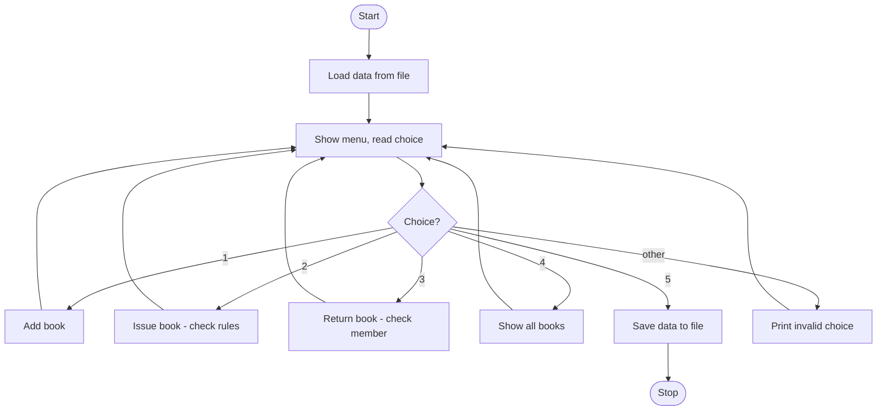

# Case Study 1: Library Management System

**Concepts used:** Dictionaries, functions, file handling (JSON), loops, conditionals

## 1. Problem Statement

A college library keeps track of books and members on paper, which makes it hard to know which books are available and who has borrowed what. Build a menu-driven program that lets the librarian add books, issue them to members, take them back and view the catalogue. Data must be saved to a file so it is not lost when the program closes. A member may hold at most 2 books at a time.

## 2. Objectives

1. Store books and members using dictionaries and lists.
2. Write separate functions for each operation (add, issue, return, show).
3. Save and load data using file handling (JSON).
4. Apply business rules: no double issue, borrowing limit of 2 books.

## 3. Assumptions

- Every book has a unique ID such as B1.
- Member names are unique and are used to identify members.
- Only one librarian uses the program at a time.
- No fines or due dates are handled.

## 4. Algorithm

1. Load saved data from library.json (or start empty).
2. Show the menu and read the choice.
3. Add: if the ID exists, reject; otherwise store the title as available.
4. Issue: check the book exists, is available and the member has fewer than 2 books; then mark it issued and record it against the member.
5. Return: check the member really holds that book; then mark it available and remove it from the member's list.
6. Show: print every book with its status.
7. Exit: save data to the file and stop.

## 5. Pseudocode

```text
LOAD data from file
LOOP forever
    DISPLAY menu, READ choice
    IF choice = 1 THEN add book if ID is new
    ELSE IF choice = 2 THEN
        IF book missing THEN error
        ELSE IF book already issued THEN error
        ELSE IF member has 2 books THEN error
        ELSE mark issued, add to member list
    ELSE IF choice = 3 THEN
        IF member does not hold book THEN error
        ELSE mark available, remove from member list
    ELSE IF choice = 4 THEN print all books
    ELSE IF choice = 5 THEN SAVE data, STOP
    ELSE print invalid choice
END LOOP
```

## 6. Flowchart

(GitHub draws this automatically. To get an image, take a screenshot of the rendered chart.)



## 7. Source Code

File: [`library_system.py`](library_system.py)

```python
"""Case Study 1: Library Management System (menu driven, saves data to a JSON file)."""
import json
import os

FILE_NAME = "library.json"   # file where data is stored between runs
MAX_BOOKS = 2                # a member can hold at most 2 books


def load_data():
    """Read saved data from the file; start empty if the file does not exist."""
    if os.path.exists(FILE_NAME):
        with open(FILE_NAME, "r") as f:
            return json.load(f)
    return {"books": {}, "members": {}}


def save_data(data):
    """Write the current data to the file."""
    with open(FILE_NAME, "w") as f:
        json.dump(data, f, indent=2)


def add_book(data, book_id, title):
    if book_id in data["books"]:
        return "Book ID already exists."
    data["books"][book_id] = {"title": title, "available": True}
    return "Book added: " + title


def issue_book(data, book_id, member):
    if book_id not in data["books"]:
        return "Book not found."
    if not data["books"][book_id]["available"]:
        return "Book is already issued."
    borrowed = data["members"].setdefault(member, [])
    if len(borrowed) >= MAX_BOOKS:
        return member + " has reached the limit of " + str(MAX_BOOKS) + " books."
    borrowed.append(book_id)
    data["books"][book_id]["available"] = False
    return "Issued '" + data["books"][book_id]["title"] + "' to " + member


def return_book(data, book_id, member):
    if book_id not in data["members"].get(member, []):
        return "This member has not borrowed that book."
    data["members"][member].remove(book_id)
    data["books"][book_id]["available"] = True
    return "Returned '" + data["books"][book_id]["title"] + "'"


def show_books(data):
    if not data["books"]:
        print("No books in library.")
    for book_id, info in data["books"].items():
        status = "Available" if info["available"] else "Issued"
        print(book_id, "|", info["title"], "|", status)


def main():
    data = load_data()
    while True:
        print("\n1.Add 2.Issue 3.Return 4.Show 5.Exit")
        choice = input("Enter choice: ").strip()
        if choice == "1":
            print(add_book(data, input("Book ID: "), input("Title: ")))
        elif choice == "2":
            print(issue_book(data, input("Book ID: "), input("Member name: ")))
        elif choice == "3":
            print(return_book(data, input("Book ID: "), input("Member name: ")))
        elif choice == "4":
            show_books(data)
        elif choice == "5":
            save_data(data)
            print("Data saved. Goodbye!")
            break
        else:
            print("Invalid choice.")


main()
```

## 8. Test Cases

Run with `python library_system.py`. Type the input values one per line, in the order shown (⏎ means press Enter).

| No. | Test description | Input (in order) | Expected output | Result |
|---|---|---|---|---|
| 1 | Add a book and show catalogue | `1 ⏎ B1 ⏎ Python ⏎ 4 ⏎ 5` | `B1 \| Python \| Available` | Pass |
| 2 | Issue an available book | `1 ⏎ B1 ⏎ Python ⏎ 2 ⏎ B1 ⏎ Ravi ⏎ 5` | `Issued 'Python' to Ravi` | Pass |
| 3 | Issue a book that is already issued | `1 ⏎ B1 ⏎ Python ⏎ 2 ⏎ B1 ⏎ Ravi ⏎ 2 ⏎ B1 ⏎ Sita ⏎ 5` | `Book is already issued.` | Pass |
| 4 | Member borrows a 3rd book | `1 ⏎ B1 ⏎ A ⏎ 1 ⏎ B2 ⏎ B ⏎ 1 ⏎ B3 ⏎ C ⏎ 2 ⏎ B1 ⏎ Ravi ⏎ 2 ⏎ B2 ⏎ Ravi ⏎ 2 ⏎ B3 ⏎ Ravi ⏎ 5` | `Ravi has reached the limit of 2 books.` | Pass |
| 5 | Return a book never borrowed | `1 ⏎ B1 ⏎ Python ⏎ 3 ⏎ B1 ⏎ Ravi ⏎ 5` | `This member has not borrowed that book.` | Pass |
| 6 | Return a borrowed book | `1 ⏎ B1 ⏎ Python ⏎ 2 ⏎ B1 ⏎ Ravi ⏎ 3 ⏎ B1 ⏎ Ravi ⏎ 5` | `Returned 'Python'` | Pass |
| 7 | Invalid menu choice | `9 ⏎ 5` | `Invalid choice.` | Pass |

## 9. Sample Output (take your screenshot of this run)

Input typed: `1 ⏎ B1 ⏎ Python ⏎ 4 ⏎ 5`

```text

1.Add 2.Issue 3.Return 4.Show 5.Exit
Enter choice: Book ID: Title: Book added: Python

1.Add 2.Issue 3.Return 4.Show 5.Exit
Enter choice: B1 | Python | Available

1.Add 2.Issue 3.Return 4.Show 5.Exit
Enter choice: Data saved. Goodbye!
```

*Add your own screenshot here:* ``

## 10. Conclusion

The program manages a small library correctly: all rules (unique IDs, no double issue, 2-book limit) are enforced and data survives between runs because it is saved in a JSON file. Using one function per operation kept the code easy to test. In future, due dates, fines and a search option could be added.
